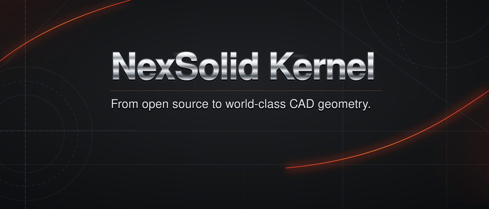

<p align="center">
  
</p>

<h1 align="center">NexSolid Kernel</h1>
<p align="center"><strong>Open-source CAD geometry, built to raise the bar.</strong></p>
<p align="center">
  <a href="https://github.com/BrixLabs-Admin/NexSolid-Kernal/actions/workflows/ci.yml"></a>
  <a href="CONTRIBUTING.md">Contribute</a> ·
  <a href="docs/GETTING_STARTED.md">Get started</a> ·
  <a href="ROADMAP.md">Roadmap</a> ·
  <a href="https://github.com/BrixLabs-Admin/NexSolid-Kernal/issues">Issues</a>
</p>

> **Project status: early-stage prototype.** NexSolid currently offers a small C++17 wrapper around Open CASCADE Technology (OCCT), a box-making CLI demo, a smoke test, and an automated Linux build. It is **not yet** a production-ready geometry kernel or a replacement for Parasolid, ACIS, or OCCT.

## The mission

**Make open-source CAD geometry as capable, dependable, and competitive as the best proprietary kernels.**

NexSolid is a community-oriented effort to build toward that ambition using OCCT as a foundation. Our priorities are reproducible geometry operations, careful tolerance handling, meaningful regression tests, a clear API, and measurable improvements. The mission is ambitious; results will be demonstrated through code, test cases, and benchmarks—not marketing claims.

## Try NexSolid

**Ubuntu 22.04** is the documented CI environment. You need CMake 3.20+, a C++17 compiler and OCCT Foundation, Modeling Data, and Modeling Algorithms development packages.

```bash
git clone https://github.com/BrixLabs-Admin/NexSolid-Kernal.git
cd NexSolid-Kernal
sudo apt update
sudo apt install -y build-essential cmake git \
  libocct-foundation-dev libocct-modeling-data-dev libocct-modeling-algorithms-dev
bash scripts/build-test.sh
```

The script configures, builds, runs the smoke test, and launches a CLI demo that constructs a box using OCCT. For other platforms, manual commands, troubleshooting and testing with patched OCCT libraries, see **[Getting Started](docs/GETTING_STARTED.md)**. macOS and Windows are not yet covered by CI.

## Join the project

You **do not need an invitation code**. Anyone can read this public repository, open issues, fork the code, and propose changes by pull request.

| Your experience | Good way to contribute |
| --- | --- |
| New to C++ or GitHub | Improve the setup guide, reproduce a bug, clarify documentation, or add a simple test |
| Comfortable with C++ | Work on API design, validation, error reporting, build tooling, and regression tests |
| Experienced with OCCT / geometry | Help define tolerance policies, reproduce geometry failures, design operations, and benchmark robustness |

**Your first steps:** [Find a good first issue](https://github.com/BrixLabs-Admin/NexSolid-Kernal/issues?q=is%3Aissue+is%3Aopen+label%3A%22good+first+issue%22) → [Read the first-contribution guide](docs/FIRST_CONTRIBUTION.md) → [Open a pull request](CONTRIBUTING.md).

Questions and ideas are welcome through [GitHub Issues](https://github.com/BrixLabs-Admin/NexSolid-Kernal/issues). Please search existing issues before opening a new one. For large changes, discuss the approach first.

## What's built and what's next

**Present today**
- CMake-based C++17 starter library wrapping OCCT APIs.
- A minimal shape/volume demonstration and an automated smoke test.
- An Ubuntu GitHub Actions build and test workflow.
- Contributor instructions and an isolated OCCT installation option for testing patched libraries.

**Planned, not yet implemented**
- More comprehensive geometric validity and regression testing.
- Well-defined tolerance, units, error-handling, and API conventions.
- Additional geometry operations, benchmark cases, and interoperability work.

The [roadmap](ROADMAP.md) distinguishes completed work from future goals. The current tests do **not** establish robustness for Booleans, fillets, or advanced topology.

## Repository map

| Path | Purpose |
| --- | --- |
| `include/nexsolid/` | Public starter headers |
| `src/` | Library implementation |
| `app/` | Executable demo |
| `tests/` | Automated tests |
| `scripts/` | Local developer scripts |
| `docs/` | Getting started, contribution and dependency documentation |
| `.github/` | CI and issue/PR templates |

## Developing with AI

AI coding assistance is welcome, but optional. Human contributors remain responsible for the correctness, provenance, and testing of submitted code. See [AI-assisted contributions](docs/AI_CONTRIBUTIONS.md).

## License and OCCT dependency

The repository owner's original NexSolid starter code is licensed under **LGPL 2.1 with the Open CASCADE additional exception** unless file-specific notices say otherwise. See [LICENSE](LICENSE), [full LGPL text](LICENSE_LGPL_21.txt), and [OCCT exception](OCCT_LGPL_EXCEPTION.txt).

OCCT is an **external dependency**, not bundled in this starter. Modified upstream OCCT source must retain the original copyright, license, and modification notices. Read [Dependency and third-party notices](docs/DEPENDENCIES.md) and [Licensing plan](docs/LICENSING_PLAN.md) before importing or redistributing third-party code.

---

<p align="center"><strong>Good geometry deserves good evidence. Build, test, measure, contribute.</strong></p>
